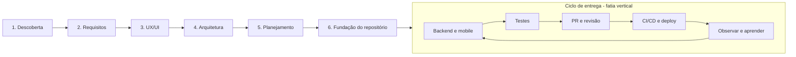

# Guia do processo de desenvolvimento

> Documento vivo. Marque os itens conforme avança. Quando uma decisão mudar, registre a mudança em um ADR (`docs/adr/`) e atualize este guia.

## Como usar este guia

- As fases **não são uma cascata**. As fases 1 a 6 preparam o terreno. Depois disso, o trabalho segue em ciclos curtos, e cada ciclo entrega uma **fatia vertical**: API + app + testes + documentação + deploy.
- Cada fase diz o que produzir e onde guardar no repositório (📁). As pastas seguem o [ADR 0002](adr/0002-monorepo-e-estrutura-do-repositorio.md).
- **Este guia descreve o processo, não as decisões.** Toda escolha relevante (stack, estrutura, banco, autenticação, hospedagem…) vira um ADR em `docs/adr/`, e o guia só aponta para ele. Assim, quando uma decisão mudar, o guia continua valendo.
- As ferramentas e bibliotecas citadas nas fases são **sugestões** para avaliar. A escolha final de cada uma que for relevante é registrada em ADR quando a fase chegar.
- A [Definition of Done](#definition-of-done) vale para toda tarefa, em qualquer fase.

## Visão geral



---

## Fases

### 1. Descoberta e concepção

**Objetivo:** saber qual problema o app resolve e para quem, antes de escrever código.

- [ ] Problema e objetivos do produto escritos
- [ ] Persona(s) definidas
- [ ] Análise de apps concorrentes (Mobills, Organizze, YNAB…): o que copiar e o que evitar
- [ ] Escopo do MVP: o que entra e, principalmente, o que fica de fora
- [ ] Métricas de sucesso (ex.: registrar uma despesa em menos de 10 segundos)

📁 `docs/product/`: visão, personas, análise de concorrentes e métricas

### 2. Levantamento de requisitos

**Objetivo:** transformar a ideia em requisitos verificáveis.

- [ ] Requisitos funcionais escritos como user stories, com critérios de aceite
- [ ] Requisitos não funcionais: segurança, desempenho, uso offline, disponibilidade, LGPD
- [ ] Regras de negócio: parcelas, recorrências, transferências entre contas, cálculo de saldo
- [ ] Glossário do domínio (o que é exatamente "conta", "transação", "categoria", "orçamento")
- [ ] Backlog priorizado (MoSCoW: Must, Should, Could, Won't)

📁 `docs/requirements/`: user stories, regras de negócio e requisitos não funcionais. Glossário em `docs/glossary.md`

Exemplo de critério de aceite em Gherkin:

```gherkin
Funcionalidade: Registrar despesa
  Como usuário, quero registrar uma despesa para acompanhar meus gastos.

  Cenário: Despesa válida
    Dado que estou autenticado e tenho a conta "Carteira" com saldo de R$ 100,00
    Quando registro uma despesa de R$ 25,90 na categoria "Alimentação"
    Então o saldo da conta "Carteira" passa a ser R$ 74,10
```

### 3. Design de UX/UI

**Objetivo:** validar as telas antes de implementá-las.

- [ ] Fluxos de usuário (onboarding, registrar transação, ver saldo, orçamento)
- [ ] Wireframes
- [ ] Protótipo navegável (Figma)
- [ ] Design system: tokens (cores, tipografia, espaçamento) e componentes base
- [ ] Revisão de acessibilidade: contraste, área de toque, leitor de tela
- [ ] Teste rápido de usabilidade com 3 a 5 pessoas

📁 `docs/design/`: links do Figma, fluxos e decisões de UX

### 4. Arquitetura

**Objetivo:** tomar as decisões estruturais e registrá-las.

- [x] Stack tecnológica definida → [ADR 0001](adr/0001-stack-tecnologica.md)
- [x] Organização do repositório definida (monorepo e estrutura de pastas) → [ADR 0002](adr/0002-monorepo-e-estrutura-do-repositorio.md)
- [ ] Diagramas C4 de contexto e de containers (Mermaid)
- [ ] Estilo arquitetural do backend, em ADR (sugestão: monolito modular, com um módulo por contexto: auth, contas, transações, categorias, orçamentos)
- [ ] Banco de dados e ORM, em ADR
- [ ] Modelo de dados (diagrama ER)
- [ ] Contrato da API em OpenAPI. Decidir em ADR entre *design-first* (escrever o contrato antes) e *code-first* (gerar com `@nestjs/swagger`)
- [ ] Estratégia de autenticação, em ADR (sugestão: access token de vida curta + refresh token rotativo, guardados no `expo-secure-store`)
- [ ] Estratégia offline e de sincronização (se for requisito)
- [ ] Modelagem de ameaças: OWASP API Security Top 10 e OWASP MASVS (mobile)
- [ ] Um ADR para cada outra decisão relevante que surgir

📁 Diagramas C4, modelo de dados e modelagem de ameaças em `docs/architecture/`. ADRs em `docs/adr/`. Contrato da API em `docs/api/openapi.yaml`

Modelo de ADR (`docs/adr/NNNN-titulo-curto.md`):

```markdown
# NNNN. Título da decisão

- Status: proposta | aceita | substituída por NNNN
- Data: AAAA-MM-DD

## Contexto
Qual problema ou força motiva esta decisão?

## Opções consideradas
As alternativas avaliadas, com prós e contras de cada uma.

## Decisão
O que foi decidido.

## Consequências
O que fica mais fácil, o que fica mais difícil e que riscos aceitamos.
```

### 5. Planejamento

- [ ] Método: Kanban (adequado para quem trabalha sozinho)
- [ ] Quadro no GitHub Projects: Backlog → Pronto → Em andamento → Em revisão → Feito
- [ ] Roadmap por marcos: MVP, v1, v2…
- [ ] Cada item do quadro ligado a uma user story de `docs/requirements/`

📁 Roadmap em `docs/product/roadmap.md`. O quadro fica no GitHub Projects, fora do repositório

### 6. Fundação do repositório

- [ ] Repositório no GitHub, com a branch `main` protegida
- [ ] Monorepo e pastas criados conforme o [ADR 0002](adr/0002-monorepo-e-estrutura-do-repositorio.md)
- [ ] Apps e pacote compartilhado gerados com a stack do [ADR 0001](adr/0001-stack-tecnologica.md)
- [ ] TypeScript em modo strict em todos os pacotes
- [ ] Lint e formatação padronizados (oxlint/ESLint + Prettier)
- [ ] Hooks de commit (Husky + lint-staged) e Conventional Commits (commitlint)
- [ ] `infra/docker-compose.yml` com o banco para desenvolvimento local
- [ ] Um `.env.example` por app. Segredos nunca vão para o Git
- [ ] Ambientes definidos: dev, staging e prod

📁 Configurações na raiz. Banco local em `infra/docker-compose.yml`. Um `.env.example` dentro de cada app. Como instalar e rodar o projeto, no `README.md` da raiz

### 7. Backend (`apps/api`)

- [ ] Um módulo Nest por contexto de domínio
- [ ] Camadas: controller → caso de uso → domínio → repositório. As regras de domínio não dependem do Nest
- [ ] Banco + ORM com migrações versionadas
- [ ] Validação de toda entrada (DTOs, ou schemas Zod de `packages/domain`)
- [ ] Erros padronizados com filtro global, no formato Problem Details (RFC 9457)
- [ ] Autenticação e autorização: cada usuário acessa somente os próprios dados
- [ ] Logs estruturados (pino), rate limiting (`@nestjs/throttler`), helmet e CORS
- [ ] Documentação OpenAPI publicada (`@nestjs/swagger`)
- [ ] Health check (`@nestjs/terminus`)

📁 Código em `apps/api/`. Particularidades da API (variáveis de ambiente, scripts) em `apps/api/README.md`

> **Regra de ouro:** dinheiro é sempre um **inteiro em centavos** no código e `BIGINT` ou `NUMERIC` no banco. Nunca `float`.

### 8. Mobile (`apps/mobile`)

- [ ] Organização por feature (`src/features/<feature>/`)
- [ ] Navegação com Expo Router
- [ ] Estado vindo do servidor com TanStack Query; estado local com Zustand
- [ ] Formulários com React Hook Form + Zod (schemas de `packages/domain`)
- [ ] Cliente HTTP tipado, gerado a partir do OpenAPI
- [ ] Tokens no `expo-secure-store`; dados offline no `expo-sqlite`
- [ ] Desbloqueio por biometria (`expo-local-authentication`)
- [ ] Estados de carregamento, erro e vazio em todas as telas
- [ ] Internacionalização e acessibilidade

📁 Código em `apps/mobile/`. Particularidades do app (como rodar no emulador, builds) em `apps/mobile/README.md`

### 9. Qualidade e testes

- [ ] Testes unitários das regras de domínio (Vitest), com TDD nas regras críticas (saldo, parcelas, recorrências)
- [ ] Testes de integração da API com banco real (Testcontainers) e testes e2e da API (supertest)
- [ ] Testes de componentes no mobile (jest-expo + React Native Testing Library)
- [ ] E2E mobile com Maestro nos fluxos críticos (login, registrar transação)
- [ ] Toda mudança entra por Pull Request, com autorrevisão
- [ ] Análise de dependências e de segurança (Dependabot ou Renovate, CodeQL)

📁 Testes unitários ao lado do código (`*.spec.ts`). Testes e2e da API em `apps/api/test/`. Fluxos do Maestro em `apps/mobile/.maestro/`. Estratégia de testes em `docs/architecture/estrategia-de-testes.md`

### 10. CI/CD

- [ ] GitHub Actions: install → lint → typecheck → test → build, rodando só nos pacotes afetados (Turborepo)
- [ ] Deploy automático da API em staging a cada merge na `main`
- [ ] EAS Build (binários), EAS Submit (envio às lojas) e EAS Update (atualizações OTA)
- [ ] Versionamento semântico e changelog (Changesets ou release-please)

📁 Workflows em `.github/workflows/`. Configuração do EAS em `apps/mobile/eas.json`. Um `CHANGELOG.md` por app, gerado pela ferramenta de versionamento

### 11. Infraestrutura e deploy

- [ ] Hospedagem da API (Render, Fly.io, Railway, AWS…), registrada em ADR
- [ ] Banco gerenciado, com backups automáticos e um teste de restauração
- [ ] Segredos guardados no provedor e no CI
- [ ] HTTPS e domínio
- [ ] (Opcional, para praticar) Infraestrutura como código com Terraform

📁 Infraestrutura como código em `infra/`. Procedimentos passo a passo (deploy manual, restauração de backup) em `docs/operations/runbooks/`

### 12. Release

- [ ] Beta pelo TestFlight (iOS) e pelo teste interno do Google Play
- [ ] Política de privacidade e termos de uso (LGPD)
- [ ] Formulários de privacidade das lojas (App Privacy e Data safety)
- [ ] Página nas lojas: ícone, screenshots e descrição
- [ ] Rollout gradual

📁 `docs/release/`: política de privacidade, termos de uso, textos das lojas e checklist de release. A política e os termos também precisam estar publicados em uma URL pública

### 13. Observabilidade e operação

- [ ] Sentry no app e na API (erros e crashes)
- [ ] Logs centralizados, métricas e traces (OpenTelemetry)
- [ ] Alertas e SLOs simples (ex.: 99% das requisições abaixo de 500 ms)
- [ ] Analytics de produto, sem enviar dados financeiros sensíveis

📁 `docs/operations/`: SLOs, alertas e runbooks de resposta a incidentes (em `runbooks/`)

### 14. Manutenção e evolução

- [ ] Triagem de bugs e de feedback
- [ ] Dívida técnica registrada no backlog
- [ ] Dependências atualizadas, incluindo o upgrade do Expo SDK a cada nova versão
- [ ] Retrospectiva a cada marco e post-mortem para cada incidente

📁 Post-mortems em `docs/operations/postmortems/`. Retrospectivas em `docs/retrospectives/`. Bugs e dívida técnica ficam como issues no GitHub

---

## Práticas transversais

- **Docs-as-code:** a documentação vive no repositório e muda no mesmo PR que o código.
- **Segurança desde o início (shift-left):** pense em ameaças na arquitetura, não só antes do release.
- **Fatias verticais:** entregue uma funcionalidade pequena de ponta a ponta em vez de "todo o backend" e depois "todo o app".
- **Passos pequenos:** commits e PRs pequenos são mais fáceis de revisar e de reverter.

## Convenções

### Branches

- Trunk-based: a `main` está sempre pronta para deploy.
- Branches curtas: `feat/registrar-despesa`, `fix/saldo-negativo`, `docs/adr-banco`.

### Commits (Conventional Commits)

```
feat(api): cria endpoint de registro de transações
fix(mobile): corrige formatação de valores negativos
docs(adr): registra a escolha do PostgreSQL
chore: atualiza dependências
```

Tipos mais usados: `feat`, `fix`, `docs`, `test`, `refactor`, `chore`, `ci`. O escopo é o pacote: `api`, `mobile`, `domain`, `adr`.

### Definition of Done

Uma tarefa só está pronta quando:

- [ ] Os critérios de aceite foram atendidos
- [ ] Há testes, e eles passam no CI
- [ ] Lint e typecheck estão sem erros
- [ ] A documentação foi atualizada (OpenAPI, ADR, README, se for o caso)
- [ ] O PR foi revisado e entrou na `main`
- [ ] A mudança está em staging e foi verificada

## Primeira fatia vertical sugerida

**"Cadastrar e listar transações"**, sem autenticação no primeiro momento:

1. User story e critérios de aceite em `docs/requirements/`
2. Tipo `Transaction` e regras de valor em `packages/domain`, com testes
3. Módulo `transactions` na API: entidade, migração, `POST /transactions` e `GET /transactions`
4. Tela de lista e formulário de cadastro no app
5. Teste e2e da API e um fluxo no Maestro
6. Pipeline de CI rodando tudo
7. Deploy em staging

## Referências

- C4 model: https://c4model.com
- ADRs: https://adr.github.io
- Conventional Commits: https://www.conventionalcommits.org/pt-br
- OWASP MASVS: https://mas.owasp.org
- OWASP API Security Top 10: https://owasp.org/API-Security
- NestJS: https://docs.nestjs.com
- Expo (monorepos): https://docs.expo.dev/guides/monorepos
- Turborepo: https://turborepo.com/docs
- pnpm workspaces: https://pnpm.io/workspaces
