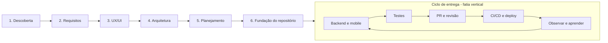

# Guia do processo de desenvolvimento

> Documento vivo. Marque os itens conforme avança. Quando uma decisão mudar, registre a mudança em um ADR (`docs/adr/`) e atualize este guia.

## Sumário

- [Como usar este guia](#como-usar-este-guia)
- [Práticas transversais](#práticas-transversais)
- [Convenções](#convenções)
- [Visão geral](#visão-geral)
- [Primeira fatia vertical sugerida](#primeira-fatia-vertical-sugerida)
- [Fases](#fases)
  - [1. Descoberta e concepção](#1-descoberta-e-concepção)
  - [2. Levantamento de requisitos](#2-levantamento-de-requisitos)
  - [3. Design de UX/UI](#3-design-de-uxui)
  - [4. Arquitetura](#4-arquitetura)
  - [5. Planejamento](#5-planejamento)
  - [6. Fundação do repositório](#6-fundação-do-repositório)
  - [7. Backend (apps/api)](#7-backend-appsapi)
  - [8. Mobile (apps/mobile)](#8-mobile-appsmobile)
  - [9. Qualidade e testes](#9-qualidade-e-testes)
  - [10. CI/CD](#10-cicd)
  - [11. Infraestrutura e deploy](#11-infraestrutura-e-deploy)
  - [12. Release](#12-release)
  - [13. Observabilidade e operação](#13-observabilidade-e-operação)
  - [14. Manutenção e evolução](#14-manutenção-e-evolução)
- [Índice de documentos](#índice-de-documentos)
- [Referências](#referências)

## Como usar este guia

- As fases **não são uma cascata**. As fases 1 a 6 preparam o terreno. Depois disso, o trabalho segue em ciclos curtos, e cada ciclo entrega uma **fatia vertical**: API + app + testes + documentação + deploy.
- Cada fase diz o que produzir e onde guardar no repositório (📁). Se a estrutura de pastas mudar, registre a mudança em ADR e atualize os caminhos deste guia.
- **Este guia descreve o processo, não as decisões.** Toda escolha relevante (stack, estrutura, banco, autenticação, hospedagem…) vira um ADR em `docs/adr/`. O guia não cita ADRs: a tabela "Já adotadas" do [Radar Tecnológico](architecture/radar-tecnologico.md) liga cada tecnologia em uso ao ADR que a decidiu. Assim, quando uma decisão mudar, só o radar precisa ser atualizado, e o guia continua valendo.
- **O guia não cita ferramentas nem bibliotecas**, nem as sugeridas nem as já escolhidas. Ele cita só padrões de mercado (normas, especificações, boas práticas). As exceções são a convenção de diagramas (Mermaid) e os destinos em `.github/`, porque os modelos de PR e de issue estão no formato do GitHub. Onde uma escolha de ferramenta é necessária, a fase diz onde registrá-la: em um ADR, se for uma decisão de arquitetura, ou no próprio documento da fase. As alternativas de cada escolha estão no [Radar Tecnológico](architecture/radar-tecnologico.md), que serve de ponto de partida para a seção "Opções consideradas" do ADR.
- Os modelos de documentos ficam em `docs/templates/` (📄). Para criar um documento, copie o modelo para o destino indicado na fase e preencha. O comentário no topo de cada modelo diz em qual modelo de mercado ele se baseia. O [índice de documentos](#índice-de-documentos) reúne todos em uma tabela.
- A [Definition of Done](#definition-of-done) vale para toda tarefa, em qualquer fase.

## Práticas transversais

- **Docs-as-code:** a documentação vive no repositório e muda no mesmo PR que o código.
- **Segurança desde o início (shift-left):** pense em ameaças na arquitetura, não só antes do release.
- **Fatias verticais:** entregue uma funcionalidade pequena de ponta a ponta em vez de "todo o backend" e depois "todo o app".
- **Passos pequenos:** commits e PRs pequenos são mais fáceis de revisar e de reverter.

## Convenções

### Branches

- Trunk-based: a `main` está sempre pronta para deploy.
- Branches curtas: `feat/registrar-despesa`, `fix/saldo-negativo`, `docs/adr-banco`.

### Commits (Conventional Commits)

```
feat(api): cria endpoint de registro de transações
fix(mobile): corrige formatação de valores negativos
docs(adr): registra a escolha do banco de dados
chore: atualiza dependências
```

Tipos mais usados: `feat`, `fix`, `docs`, `test`, `refactor`, `chore`, `ci`. O escopo é o pacote: `api`, `mobile`, `domain`, `adr`.

### Rastreabilidade

Todo requisito tem um identificador permanente, que nunca é reaproveitado: `US-NNN` para histórias, `RN-NN` para regras de negócio e `RNF-NN` para requisitos não funcionais. Os identificadores ligam os artefatos entre si:

- histórias citam as regras de negócio e os requisitos não funcionais que aplicam;
- PRs citam as histórias e as regras que implementam, na seção "Por quê" do modelo de PR;
- testes citam, no nome ou na descrição, a história ou a regra que verificam (ex.: um teste chamado "RN-01: calcula o saldo da conta");
- commits podem citar o identificador no rodapé da mensagem, como prevê o Conventional Commits (ex.: `Refs: US-001`).

Assim dá para seguir um requisito da especificação até o código e os testes, e saber o que é afetado quando ele muda.

### Diagramas

Diagramas são escritos em Mermaid, dentro dos próprios documentos. Assim ficam versionados junto do texto e aparecem renderizados no GitHub e no preview do VS Code.

### Definition of Done

Uma tarefa só está pronta quando:

- [ ] Os critérios de aceite foram atendidos
- [ ] Há testes, e eles passam no CI
- [ ] Lint e typecheck estão sem erros
- [ ] A documentação foi atualizada (OpenAPI, ADR, README, se for o caso)
- [ ] O PR foi revisado e entrou na `main`
- [ ] A mudança está em staging e foi verificada

## Visão geral



## Primeira fatia vertical sugerida

Comece depois de concluir as fases 1 a 6. A primeira fatia é a primeira volta do ciclo de entrega mostrado no diagrama da visão geral.

**"Cadastrar e listar transações"**, sem autenticação no primeiro momento:

1. User story e critérios de aceite em `docs/requirements/`
2. Tipo `Transaction` e regras de valor em `packages/domain`, com testes
3. Módulo `transactions` na API: entidade, migração, `POST /transactions` e `GET /transactions`
4. Tela de lista e formulário de cadastro no app
5. Teste de ponta a ponta da API e um teste de ponta a ponta no app
6. Pipeline de CI rodando tudo
7. Deploy em staging

---

## Fases

### 1. Descoberta e concepção

**Objetivo:** saber qual problema o app resolve e para quem, antes de escrever código.

**Entregável principal: o Documento de Visão.** É o primeiro documento técnico do projeto. Ele define o problema, para quem é o produto e os limites do escopo, e serve de base para os requisitos, a arquitetura e os ADRs. Ele não traz requisitos detalhados nem planejamento.

- [x] Documento de Visão escrito ([modelo](templates/documento-de-visao.md))
- [x] Documento revisado antes de começar os requisitos

📁 `docs/product/visao.md`. Se alguma seção crescer demais (personas, análise de concorrentes), mova para um arquivo próprio em `docs/product/` e coloque o link na visão.

📄 Modelo: [`docs/templates/documento-de-visao.md`](templates/documento-de-visao.md)

### 2. Levantamento de requisitos

**Objetivo:** transformar a visão em requisitos verificáveis.

**Entregável principal: a Especificação de Requisitos.** Ela detalha o que foi definido no Documento de Visão: o que o sistema deve fazer (requisitos funcionais), com que qualidade (requisitos não funcionais) e sob quais regras de negócio. Nas metodologias tradicionais, esse documento se chama ERS (Especificação de Requisitos de Software) e segue a norma ISO/IEC/IEEE 29148. Aqui ele usa o formato ágil, com user stories e critérios de aceite, e fica organizado em uma pasta em vez de um arquivo único, porque cresce ao longo do projeto. Cada requisito recebe um identificador, conforme a convenção de [rastreabilidade](#rastreabilidade).

- [ ] Índice da especificação, com as histórias por épico e prioridade ([modelo](templates/indice-de-requisitos.md))
- [ ] Requisitos funcionais como user stories, cada uma com critérios de aceite ([modelo](templates/user-story.md))
- [ ] Regras de negócio ([modelo](templates/regras-de-negocio.md))
- [ ] Requisitos não funcionais ([modelo](templates/requisitos-nao-funcionais.md))
- [ ] Glossário do domínio ([modelo](templates/glossario.md))
- [ ] Especificação revisada contra o Documento de Visão: tudo o que está no escopo do MVP tem histórias, e nenhuma história está fora do escopo

📁 Especificação em `docs/requirements/`. Glossário em `docs/glossary.md`. O destino de cada arquivo está no [índice de documentos](#índice-de-documentos)

📄 Modelos:

- Índice da especificação (`README.md`): [`indice-de-requisitos.md`](templates/indice-de-requisitos.md)
- User story, com um exemplo de critério de aceite em Gherkin: [`user-story.md`](templates/user-story.md)
- Regras de negócio: [`regras-de-negocio.md`](templates/regras-de-negocio.md)
- Requisitos não funcionais: [`requisitos-nao-funcionais.md`](templates/requisitos-nao-funcionais.md)
- Glossário: [`glossario.md`](templates/glossario.md)

### 3. Design de UX/UI

**Objetivo:** validar as telas antes de implementá-las.

**Entregável principal: a Especificação de UX/UI**, junto com o protótipo navegável. O protótipo mostra as telas; a especificação guarda no repositório os fluxos, o inventário de telas, o design system, os critérios de acessibilidade e o resultado do teste de usabilidade.

- [ ] Fluxos de usuário (onboarding, registrar transação, ver saldo, orçamento)
- [ ] Wireframes
- [ ] Protótipo navegável, com a ferramenta e o link registrados na especificação ([ver opções](architecture/radar-tecnologico.md#ferramenta-de-prototipação))
- [ ] Design system: tokens (cores, tipografia, espaçamento) e componentes base
- [ ] Revisão de acessibilidade: contraste, área de toque, leitor de tela
- [ ] Teste rápido de usabilidade com 3 a 5 pessoas

📁 `docs/design/especificacao-de-ux.md`. O protótipo fica na ferramenta de prototipação, com o link na especificação

📄 Modelo: [`especificacao-de-ux.md`](templates/especificacao-de-ux.md)

### 4. Arquitetura

**Objetivo:** tomar as decisões estruturais e registrá-las.

**Entregáveis principais: o Documento de Arquitetura e o Modelo de Ameaças**, além dos ADRs e do contrato da API. O Documento de Arquitetura reúne os diagramas C4 (seções 3 e 5), o modelo de dados (seção 8) e o índice dos ADRs (seção 9). O Modelo de Ameaças registra a análise de segurança. O Radar Tecnológico reúne as opções de cada decisão ainda em aberto.

- [x] Stack tecnológica definida, em ADR
- [x] Organização do repositório e estrutura de pastas definidas, em ADR
- [ ] Diagramas C4 de contexto e de containers
- [ ] Estilo arquitetural do backend, em ADR ([ver opções](architecture/radar-tecnologico.md#estilo-arquitetural-do-backend))
- [ ] Banco de dados e ORM, em ADR ([opções de banco](architecture/radar-tecnologico.md#banco-de-dados) e [de ORM](architecture/radar-tecnologico.md#acesso-a-dados-e-orm))
- [ ] Modelo de dados (diagrama ER)
- [ ] Contrato da API em OpenAPI. Decidir em ADR entre *design-first* (escrever o contrato antes) e *code-first* (gerar o contrato a partir do código) ([ver opções](architecture/radar-tecnologico.md#contrato-da-api))
- [ ] Estratégia de autenticação, em ADR ([ver opções](architecture/radar-tecnologico.md#autenticação))
- [ ] Estratégia offline e de sincronização (se for requisito) ([ver opções](architecture/radar-tecnologico.md#offline-e-sincronização))
- [ ] Modelagem de ameaças: OWASP API Security Top 10 e OWASP MASVS (mobile)
- [ ] Um ADR para cada outra decisão relevante que surgir

📁 Documento de Arquitetura em `docs/architecture/arquitetura.md`. Modelo de Ameaças em `docs/architecture/modelo-de-ameacas.md`. Radar Tecnológico em `docs/architecture/radar-tecnologico.md`. ADRs em `docs/adr/`. Contrato da API em `docs/api/openapi.yaml`

📄 Modelos:

- Documento de Arquitetura: [`documento-de-arquitetura.md`](templates/documento-de-arquitetura.md)
- Modelo de Ameaças: [`modelo-de-ameacas.md`](templates/modelo-de-ameacas.md)
- ADR: [`adr.md`](templates/adr.md)
- Radar Tecnológico: [`radar-tecnologico.md`](templates/radar-tecnologico.md)
- Contrato da API: [`openapi.yaml`](templates/openapi.yaml)

### 5. Planejamento

**Entregável principal: o Roadmap**, no formato Now-Next-Later. O roadmap mostra a direção do produto; o quadro de tarefas acompanha a execução.

- [ ] Método: Kanban (adequado para quem trabalha sozinho)
- [ ] Quadro de tarefas com as colunas Backlog → Pronto → Em andamento → Em revisão → Feito ([ver opções](architecture/radar-tecnologico.md#quadro-de-tarefas))
- [ ] Roadmap por marcos: MVP, v1, v2…
- [ ] Cada item do quadro ligado a uma user story de `docs/requirements/` pelo identificador (`US-NNN`)

📁 Roadmap em `docs/product/roadmap.md`. O quadro fica na ferramenta de gestão de tarefas, fora do repositório

📄 Modelo: [`roadmap.md`](templates/roadmap.md)

### 6. Fundação do repositório

**Entregável principal: o repositório pronto para desenvolver**, com o `README.md` da raiz explicando como instalar e rodar o projeto.

- [ ] Repositório remoto criado, com a branch `main` protegida
- [ ] Estrutura de pastas criada conforme o ADR de organização do repositório
- [ ] Projetos iniciais do backend, do app e do código compartilhado gerados com a stack decidida
- [ ] Verificação de tipos no modo mais estrito em todos os pacotes
- [ ] Lint e formatação automática de código, com as ferramentas em ADR ([ver opções](architecture/radar-tecnologico.md#formatação-de-código))
- [ ] Hooks de commit que rodam lint e formatação, e validação das mensagens no padrão Conventional Commits, com as ferramentas em ADR ([ver opções](architecture/radar-tecnologico.md#hooks-de-commit))
- [ ] Banco de dados local para desenvolvimento, configurado em `infra/`, com a ferramenta em ADR ([ver opções](architecture/radar-tecnologico.md#banco-de-dados-local))
- [ ] Um `.env.example` por app. Segredos nunca vão para o Git
- [ ] Ambientes definidos: dev, staging e prod

📁 Configurações na raiz. Configuração do banco local em `infra/`. Um `.env.example` dentro de cada app. Como instalar e rodar o projeto, no `README.md` da raiz

📄 Modelo: [`readme.md`](templates/readme.md)

### 7. Backend (`apps/api`)

**Entregável principal: a API funcionando e documentada**: código em `apps/api`, contrato OpenAPI publicado e `apps/api/README.md`.

- [ ] Um módulo por contexto de domínio
- [ ] Camadas: controller → caso de uso → domínio → repositório. As regras de domínio não dependem do framework
- [ ] Banco + ORM com migrações versionadas
- [ ] Validação de toda entrada, com a abordagem em ADR ([ver opções](architecture/radar-tecnologico.md#validação-de-entrada))
- [ ] Erros padronizados com filtro global, no formato Problem Details (RFC 9457)
- [ ] Autenticação e autorização: cada usuário acessa somente os próprios dados
- [ ] Logs estruturados, limite de requisições (rate limiting), cabeçalhos de segurança HTTP e CORS, com as bibliotecas em ADR ([opções de logs](architecture/radar-tecnologico.md#logs-estruturados) e [de proteções HTTP](architecture/radar-tecnologico.md#proteções-http))
- [ ] Documentação OpenAPI publicada, conforme o ADR do contrato da API ([ver opções](architecture/radar-tecnologico.md#contrato-da-api))
- [ ] Endpoint de health check ([ver opções](architecture/radar-tecnologico.md#health-check))

📁 Código em `apps/api/`. Particularidades da API (variáveis de ambiente, scripts) em `apps/api/README.md`

📄 Modelos: README [`readme.md`](templates/readme.md) e contrato da API [`openapi.yaml`](templates/openapi.yaml)

> **Regra de ouro:** dinheiro é sempre um **inteiro em centavos** no código e `BIGINT` ou `NUMERIC` no banco. Nunca `float`.

### 8. Mobile (`apps/mobile`)

**Entregável principal: o app funcionando**, com o `apps/mobile/README.md` explicando como rodar e gerar builds.

- [ ] Organização por feature (`src/features/<feature>/`)
- [ ] Navegação entre telas
- [ ] Gerenciamento do estado vindo da API e do estado local do app, em ADR ([ver opções](architecture/radar-tecnologico.md#gerenciamento-de-estado))
- [ ] Formulários com validação que reaproveita as regras de `packages/domain`, com as bibliotecas em ADR ([ver opções](architecture/radar-tecnologico.md#formulários))
- [ ] Cliente HTTP tipado, gerado a partir do OpenAPI ([ver opções](architecture/radar-tecnologico.md#cliente-http-gerado-do-openapi))
- [ ] Armazenamento seguro de tokens no dispositivo e armazenamento local para dados offline, com as bibliotecas em ADR ([opções de tokens](architecture/radar-tecnologico.md#armazenamento-seguro-de-tokens) e [de dados offline](architecture/radar-tecnologico.md#offline-e-sincronização))
- [ ] Desbloqueio por biometria ([ver opções](architecture/radar-tecnologico.md#biometria))
- [ ] Estados de carregamento, erro e vazio em todas as telas
- [ ] Internacionalização e acessibilidade

📁 Código em `apps/mobile/`. Particularidades do app (como rodar no emulador, builds) em `apps/mobile/README.md`

📄 Modelo: [`readme.md`](templates/readme.md)

### 9. Qualidade e testes

**Entregável principal: a Estratégia de Testes**, que define o que testar, em qual nível, com quais critérios e com quais ferramentas, cada uma registrada em ADR. As opções estão no radar, em [testes da API e do domínio](architecture/radar-tecnologico.md#testes-da-api-e-do-domínio) e [testes do app](architecture/radar-tecnologico.md#testes-do-app). O [modelo de Pull Request](templates/pull-request.md) leva a Definition of Done para todo PR.

- [ ] Testes unitários das regras de domínio, com TDD nas regras críticas (saldo, parcelas, recorrências)
- [ ] Testes de integração da API com banco real e testes de ponta a ponta da API
- [ ] Testes de componentes no app
- [ ] Testes de ponta a ponta no app, nos fluxos críticos (login, registrar transação)
- [ ] Toda mudança entra por Pull Request, com autorrevisão
- [ ] Análise automática de dependências vulneráveis e análise estática de segurança, com as ferramentas em ADR ([ver opções](architecture/radar-tecnologico.md#segurança-de-dependências-e-código))

📁 Testes unitários ao lado do código (`*.spec.ts`). Testes e2e da API em `apps/api/test/`. Testes de ponta a ponta do app em `apps/mobile/`, na pasta que a ferramenta escolhida usar. Estratégia de testes em `docs/architecture/estrategia-de-testes.md`. Modelo de PR em `.github/pull_request_template.md`

📄 Modelos:

- Estratégia de Testes: [`estrategia-de-testes.md`](templates/estrategia-de-testes.md)
- Pull Request: [`pull-request.md`](templates/pull-request.md)

### 10. CI/CD

**Entregável principal: o pipeline de CI/CD funcionando**, com um `CHANGELOG.md` por app registrando o que muda em cada versão.

- [ ] Pipeline de CI em `.github/workflows/`: install → lint → typecheck → test → build, rodando só nos pacotes afetados pela mudança
- [ ] Deploy automático da API em staging a cada merge na `main`
- [ ] Build dos binários, envio às lojas e atualizações OTA do app, com o serviço em ADR ([ver opções](architecture/radar-tecnologico.md#build-e-distribuição-do-app))
- [ ] Versionamento semântico e changelog, com a ferramenta em ADR ([ver opções](architecture/radar-tecnologico.md#versionamento-e-changelog))

📁 Workflows em `.github/workflows/`. Configuração de build do app em `apps/mobile/`. Um `CHANGELOG.md` por app, gerado pela ferramenta de versionamento

📄 Modelo: [`changelog.md`](templates/changelog.md)

### 11. Infraestrutura e deploy

**Entregável principal: o ambiente de produção no ar**, com a visão de implantação preenchida na seção 7 do Documento de Arquitetura e um runbook para cada procedimento manual (deploy, restauração de backup).

- [ ] Hospedagem da API, em ADR ([ver opções](architecture/radar-tecnologico.md#hospedagem-da-api))
- [ ] Banco gerenciado, com backups automáticos e um teste de restauração ([ver opções](architecture/radar-tecnologico.md#banco-gerenciado))
- [ ] Segredos guardados no provedor e no CI
- [ ] HTTPS e domínio
- [ ] (Opcional, para praticar) Infraestrutura como código, com a ferramenta em ADR ([ver opções](architecture/radar-tecnologico.md#infraestrutura-como-código))

📁 Infraestrutura como código em `infra/`. Procedimentos passo a passo (deploy manual, restauração de backup) em `docs/operations/runbooks/`

📄 Modelos: runbook [`runbook.md`](templates/runbook.md) e Documento de Arquitetura [`documento-de-arquitetura.md`](templates/documento-de-arquitetura.md) (seção 7)

### 12. Release

**Entregáveis principais: a Política de Privacidade, os Termos de Uso e o checklist de release** de cada versão publicada nas lojas.

- [ ] Beta pelo TestFlight (iOS) e pelo teste interno do Google Play
- [ ] Política de privacidade e termos de uso (LGPD)
- [ ] Formulários de privacidade das lojas (App Privacy e Data safety)
- [ ] Página nas lojas: ícone, screenshots e descrição
- [ ] Rollout gradual

📁 `docs/release/`: `politica-de-privacidade.md`, `termos-de-uso.md` e um `release-X.Y.Z.md` por versão, com o checklist e os textos das lojas. A política e os termos também precisam estar publicados em uma URL pública

📄 Modelos:

- Política de Privacidade: [`politica-de-privacidade.md`](templates/politica-de-privacidade.md)
- Termos de Uso: [`termos-de-uso.md`](templates/termos-de-uso.md)
- Checklist de release: [`checklist-de-release.md`](templates/checklist-de-release.md)

### 13. Observabilidade e operação

**Entregável principal: o documento de SLOs**, com indicadores, metas e orçamento de erro, e um runbook para cada alerta.

- [ ] Monitoramento de erros e crashes no app e na API, com o serviço em ADR ([ver opções](architecture/radar-tecnologico.md#monitoramento-de-erros-e-telemetria))
- [ ] Logs centralizados, métricas e traces, seguindo o padrão OpenTelemetry ([ver opções](architecture/radar-tecnologico.md#monitoramento-de-erros-e-telemetria))
- [ ] Alertas e SLOs simples (ex.: 99% das requisições abaixo de 500 ms)
- [ ] Analytics de produto, sem enviar dados financeiros sensíveis ([ver opções](architecture/radar-tecnologico.md#analytics-de-produto))

📁 SLOs em `docs/operations/slo.md`. Runbooks de resposta a incidentes em `docs/operations/runbooks/`

📄 Modelos: SLOs [`slo.md`](templates/slo.md) e runbook [`runbook.md`](templates/runbook.md)

### 14. Manutenção e evolução

**Entregáveis principais: post-mortems, retrospectivas e issues**: um post-mortem para cada incidente, uma retrospectiva a cada marco, e bugs e dívida técnica registrados como issues.

- [ ] Triagem de bugs e de feedback
- [ ] Dívida técnica registrada no backlog
- [ ] Dependências atualizadas, incluindo os upgrades de versão dos frameworks do app e do backend
- [ ] Retrospectiva a cada marco e post-mortem para cada incidente

📁 Post-mortems em `docs/operations/postmortems/`. Retrospectivas em `docs/retrospectives/`. Bugs e dívida técnica ficam como issues no repositório remoto, com o modelo de bug em `.github/ISSUE_TEMPLATE/`

📄 Modelos:

- Post-mortem: [`postmortem.md`](templates/postmortem.md)
- Retrospectiva: [`retrospectiva.md`](templates/retrospectiva.md)
- Relato de bug: [`bug-report.md`](templates/bug-report.md)

---

## Índice de documentos

| Documento | Fase | Modelo | Baseado em | Destino |
| --- | --- | --- | --- | --- |
| Documento de Visão | 1 | [`documento-de-visao.md`](templates/documento-de-visao.md) | RUP (Visão) e Wiegers (Vision and Scope) | `docs/product/visao.md` |
| Índice da Especificação de Requisitos | 2 | [`indice-de-requisitos.md`](templates/indice-de-requisitos.md) | Product Backlog (Scrum) e MoSCoW | `docs/requirements/README.md` |
| User story | 2 | [`user-story.md`](templates/user-story.md) | Connextra e Gherkin | `docs/requirements/historias/US-NNN-titulo-curto.md` |
| Regras de negócio | 2 | [`regras-de-negocio.md`](templates/regras-de-negocio.md) | Catálogo de regras de Wiegers e Beatty | `docs/requirements/regras-de-negocio.md` |
| Requisitos não funcionais | 2 | [`requisitos-nao-funcionais.md`](templates/requisitos-nao-funcionais.md) | ISO/IEC 25010:2023 e Volere | `docs/requirements/requisitos-nao-funcionais.md` |
| Glossário | 2 | [`glossario.md`](templates/glossario.md) | Linguagem ubíqua (DDD) e arc42 | `docs/glossary.md` |
| Especificação de UX/UI | 3 | [`especificacao-de-ux.md`](templates/especificacao-de-ux.md) | WCAG 2.2 AA, Apple HIG e Material Design | `docs/design/especificacao-de-ux.md` |
| Documento de Arquitetura | 4 | [`documento-de-arquitetura.md`](templates/documento-de-arquitetura.md) | arc42 e C4 model | `docs/architecture/arquitetura.md` |
| Modelo de Ameaças | 4 | [`modelo-de-ameacas.md`](templates/modelo-de-ameacas.md) | Quatro perguntas de Shostack e STRIDE | `docs/architecture/modelo-de-ameacas.md` |
| ADR | 4 em diante | [`adr.md`](templates/adr.md) | Nygard e MADR | `docs/adr/NNNN-titulo-curto.md` |
| Radar Tecnológico | 4 em diante | [`radar-tecnologico.md`](templates/radar-tecnologico.md) | Technology Radar (Thoughtworks) | `docs/architecture/radar-tecnologico.md` |
| Contrato da API | 4 e 7 | [`openapi.yaml`](templates/openapi.yaml) | OpenAPI 3.2 e RFC 9457 | `docs/api/openapi.yaml` |
| Roadmap | 5 | [`roadmap.md`](templates/roadmap.md) | Now-Next-Later | `docs/product/roadmap.md` |
| README | 6 a 8 | [`readme.md`](templates/readme.md) | Standard Readme | `README.md`, `apps/api/README.md`, `apps/mobile/README.md` |
| Estratégia de Testes | 9 | [`estrategia-de-testes.md`](templates/estrategia-de-testes.md) | ISO/IEC/IEEE 29119-3 e pirâmide de testes | `docs/architecture/estrategia-de-testes.md` |
| Modelo de Pull Request | 9 | [`pull-request.md`](templates/pull-request.md) | Modelos de PR do GitHub | `.github/pull_request_template.md` |
| Changelog | 10 | [`changelog.md`](templates/changelog.md) | Keep a Changelog e SemVer | `apps/api/CHANGELOG.md`, `apps/mobile/CHANGELOG.md` |
| Runbook | 11 e 13 | [`runbook.md`](templates/runbook.md) | Estrutura usual de runbooks em SRE | `docs/operations/runbooks/titulo-curto.md` |
| Política de Privacidade | 12 | [`politica-de-privacidade.md`](templates/politica-de-privacidade.md) | LGPD, arts. 9 e 18 | `docs/release/politica-de-privacidade.md` |
| Termos de Uso | 12 | [`termos-de-uso.md`](templates/termos-de-uso.md) | Estrutura comum de apps (sem padrão validado) | `docs/release/termos-de-uso.md` |
| Checklist de release | 12 | [`checklist-de-release.md`](templates/checklist-de-release.md) | Requisitos da App Store Connect e do Play Console | `docs/release/release-X.Y.Z.md` |
| SLOs | 13 | [`slo.md`](templates/slo.md) | Google SRE Workbook | `docs/operations/slo.md` |
| Post-mortem | 14 | [`postmortem.md`](templates/postmortem.md) | Google SRE Book | `docs/operations/postmortems/AAAA-MM-DD-titulo-curto.md` |
| Retrospectiva | 14 | [`retrospectiva.md`](templates/retrospectiva.md) | Derby e Larsen (Agile Retrospectives) | `docs/retrospectives/AAAA-MM-DD-nome-do-marco.md` |
| Relato de bug | 14 | [`bug-report.md`](templates/bug-report.md) | Modelos de issue do GitHub | `.github/ISSUE_TEMPLATE/bug-report.md` |

## Referências

- C4 model: https://c4model.com
- ADRs: https://adr.github.io
- Conventional Commits: https://www.conventionalcommits.org/pt-br
- OWASP MASVS: https://mas.owasp.org
- OWASP API Security Top 10: https://owasp.org/API-Security
- arc42: https://arc42.org
- MADR: https://adr.github.io/madr/
- ISO/IEC 25010:2023: https://www.iso.org/standard/78176.html
- Threat Modeling Manifesto: https://www.threatmodelingmanifesto.org
- WCAG 2.2: https://www.w3.org/TR/WCAG22/
- OpenAPI Specification: https://spec.openapis.org/oas/latest.html
- Standard Readme: https://github.com/RichardLitt/standard-readme
- Keep a Changelog: https://keepachangelog.com/pt-BR/1.1.0/
- Google SRE (livros e Workbook): https://sre.google/books/
- LGPD (Lei 13.709/2018): https://www.planalto.gov.br/ccivil_03/_ato2015-2018/2018/lei/l13709.htm
