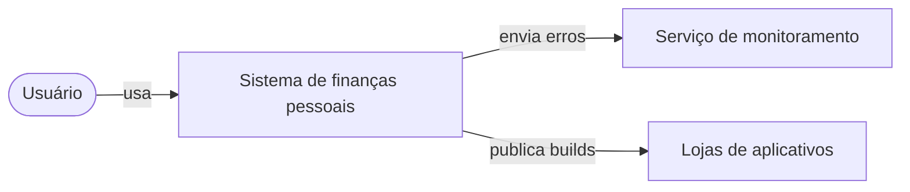
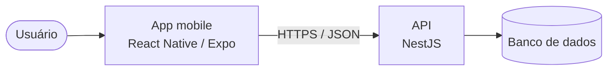
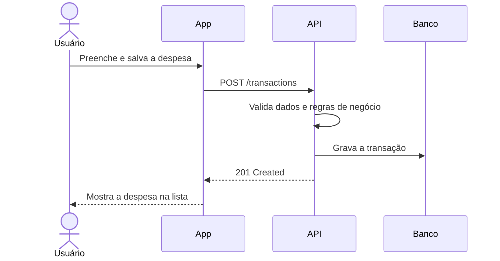
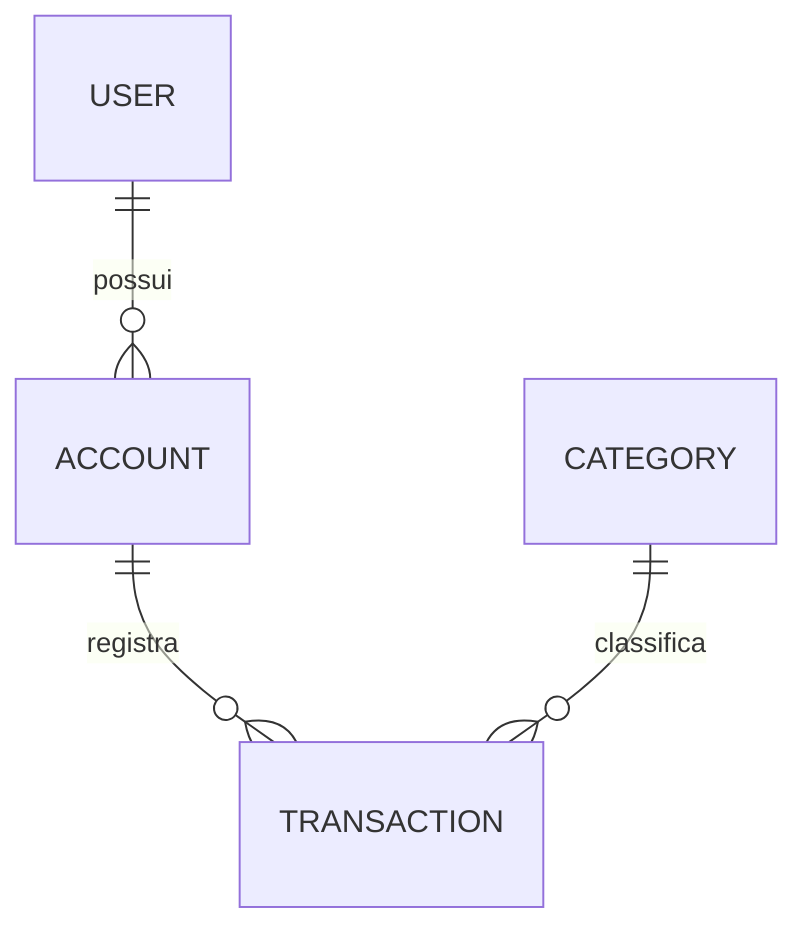

# Documento de Arquitetura

<!--
Modelo. Copie para docs/architecture/arquitetura.md.
Baseado em:
- arc42 (Gernot Starke e Peter Hruschka): as 12 seções do modelo, na mesma ordem.
- C4 model (Simon Brown): diagramas de contexto (nível 1), containers (nível 2) e componentes (nível 3).

O arc42 não é um formulário: preencha só o que ajuda a entender o sistema e deixe seções vazias com "Não se aplica por enquanto".
As decisões ficam nos ADRs (docs/adr/). Este documento resume e aponta para eles, sem repetir o conteúdo.
Os diagramas são exemplos: ajuste à arquitetura real.
-->

- Versão: 0.1
- Data: AAAA-MM-DD

## 1. Introdução e objetivos

### Requisitos principais

<!-- Resumo do que o sistema faz. Aponte para o Documento de Visão e para a Especificação de Requisitos. -->

### Objetivos de qualidade

<!-- Os três a cinco requisitos de qualidade mais importantes, com o ID do requisito não funcional. -->

| Prioridade | Objetivo de qualidade | Requisito |
| --- | --- | --- |
| 1 | <!-- ex.: proteger os dados financeiros do usuário --> | <!-- RNF-NN --> |

### Partes interessadas

| Papel | Expectativa em relação à arquitetura |
| --- | --- |
| <!-- ex.: usuário final --> | <!-- ex.: app rápido e que funcione offline --> |

## 2. Restrições

<!-- Limites impostos de fora: tecnologia (ADR 0001), organização do código (ADR 0002), leis (LGPD), orçamento, prazo. -->

| Restrição | Origem |
| --- | --- |
| <!-- restrição --> | <!-- ADR, lei, decisão de produto --> |

## 3. Contexto e escopo

<!-- Diagrama de contexto (C4 nível 1): o sistema como uma caixa, quem o usa e com quais sistemas externos ele conversa. -->

| Interface externa | O que troca |
| --- | --- |
| <!-- sistema externo --> | <!-- dados enviados e recebidos --> |

## 4. Estratégia da solução

<!-- As decisões fundamentais em poucas linhas, cada uma com o link para o ADR correspondente. -->

## 5. Visão de blocos de construção

### Nível 1: containers (C4 nível 2)

### Nível 2: componentes da API (C4 nível 3)

<!-- Os módulos da API (um por contexto de domínio) e as dependências entre eles. -->

## 6. Visão de tempo de execução

<!-- Os cenários mais importantes, como diagramas de sequência. O cenário abaixo é um exemplo. -->

### Registrar despesa

## 7. Visão de implantação

<!-- Onde cada container roda em cada ambiente. Preencha na fase 11 do guia. -->

| Container | Desenvolvimento | Staging | Produção |
| --- | --- | --- | --- |
| API | <!-- ex.: local --> | <!-- provedor --> | <!-- provedor --> |
| Banco de dados | <!-- local, conforme ADR --> | <!-- serviço gerenciado --> | <!-- serviço gerenciado --> |
| App mobile | Expo Go / emulador | <!-- ex.: build interno --> | Lojas |

## 8. Conceitos transversais

### Modelo de domínio e de dados

### Outros conceitos

<!-- Um parágrafo para cada tema que vale para o sistema todo. Remova os que não se aplicam. -->

- **Valores monetários:** <!-- ex.: inteiros em centavos -->
- **Autenticação e autorização:** <!-- ADR correspondente -->
- **Validação de entrada:** <!-- onde e como -->
- **Tratamento de erros:** <!-- formato das respostas de erro -->
- **Logs e observabilidade:** <!-- o que registrar e onde -->
- **Offline e sincronização:** <!-- se for requisito -->

## 9. Decisões de arquitetura

| ADR | Decisão | Status |
| --- | --- | --- |
| 0001 | Stack tecnológica | Aceita |
| 0002 | Monorepo e estrutura do repositório | Aceita |

## 10. Requisitos de qualidade

### 10.1 Visão geral

<!-- Aponte para docs/requirements/requisitos-nao-funcionais.md. -->

### 10.2 Cenários de qualidade

| ID | Cenário | Requisito |
| --- | --- | --- |
| CQ-01 | <!-- ex.: com 1.000 transações no mês, a lista carrega em até 300 ms --> | <!-- RNF-NN --> |

## 11. Riscos e dívidas técnicas

| Risco ou dívida | Impacto | Mitigação ou plano |
| --- | --- | --- |
| <!-- descrição --> | <!-- alto, médio ou baixo --> | <!-- o que fazer --> |

## 12. Glossário

Os termos do domínio estão em `docs/glossary.md`. Aqui ficam só os termos técnicos que não aparecem lá.

## Histórico de versões

| Data | Versão | Descrição |
| --- | --- | --- |
| AAAA-MM-DD | 0.1 | Criação do documento |
