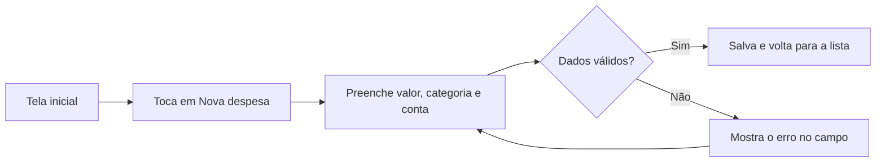

# Especificação de UX/UI

<!--
Modelo. Copie para docs/design/especificacao-de-ux.md.
Baseado em:
- WCAG 2.2 (W3C), nível AA, para os critérios de acessibilidade.
- Apple Human Interface Guidelines e Material Design, para a área mínima de toque em cada plataforma.
- Teste de usabilidade com poucos participantes, como recomenda o Nielsen Norman Group.
Não existe um padrão único para especificação de UX: esta estrutura reúne fluxos, inventário de telas,
design system e acessibilidade, que são as partes que costumam aparecer na entrega de design para desenvolvimento.

O protótipo fica na ferramenta de prototipação. Este documento guarda os links e as decisões, para que vivam junto do código.
-->

- Versão: 0.1
- Data: AAAA-MM-DD
- Protótipo: <!-- ferramenta e link -->

## 1. Contexto

<!-- Para quem são as telas e o que precisam resolver. Aponte para as personas do Documento de Visão (`docs/product/visao.md`). -->

## 2. Fluxos de usuário

<!-- Um diagrama por fluxo principal, com as histórias que ele cobre. O fluxo abaixo é um exemplo. -->

### Registrar despesa (US-NNN)

## 3. Inventário de telas

| Tela | Objetivo | Histórias | Estados previstos | Link no protótipo |
| --- | --- | --- | --- | --- |
| <!-- nome --> | <!-- o que o usuário faz aqui --> | <!-- US-NNN --> | Carregando, vazio, erro, sucesso | <!-- link --> |

## 4. Design system

### Tokens

| Token | Valor | Uso |
| --- | --- | --- |
| `color.primary` | <!-- #RRGGBB --> | Ações principais |
| `color.danger` | <!-- #RRGGBB --> | Despesas, erros |
| `font.size.body` | <!-- ex.: 16 --> | Texto corrido |
| `space.md` | <!-- ex.: 16 --> | Espaçamento padrão |

### Componentes base

<!-- Botão, campo de texto, campo de valor monetário, item de lista, cabeçalho, estado vazio… -->

## 5. Acessibilidade (WCAG 2.2 AA)

- [ ] Contraste de pelo menos 4,5:1 para texto normal e 3:1 para texto grande e componentes de interface
- [ ] Área de toque de pelo menos 24 × 24 px (mínimo do WCAG 2.2 AA). Para mobile, prefira 44 × 44 pt no iOS e 48 × 48 dp no Android
- [ ] Toda imagem e ícone com função tem rótulo para leitor de tela (VoiceOver e TalkBack)
- [ ] Informação não depende só de cor (ex.: despesa em vermelho também tem sinal de menos)
- [ ] Texto acompanha o tamanho de fonte escolhido no sistema
- [ ] Mensagens de erro dizem o que aconteceu e como corrigir

## 6. Teste de usabilidade

- **Participantes:** <!-- 3 a 5 pessoas do público-alvo -->
- **Tarefas:** <!-- ex.: "registre um gasto de R$ 25,90 no mercado" -->
- **Achados:** <!-- o que travou, o que confundiu, o que funcionou -->
- **Mudanças decididas:** <!-- o que muda no protótipo -->

## 7. Decisões e pendências

<!-- Decisões de UX com o motivo, e dúvidas em aberto. -->

## Histórico de versões

| Data | Versão | Descrição |
| --- | --- | --- |
| AAAA-MM-DD | 0.1 | Criação do documento |
