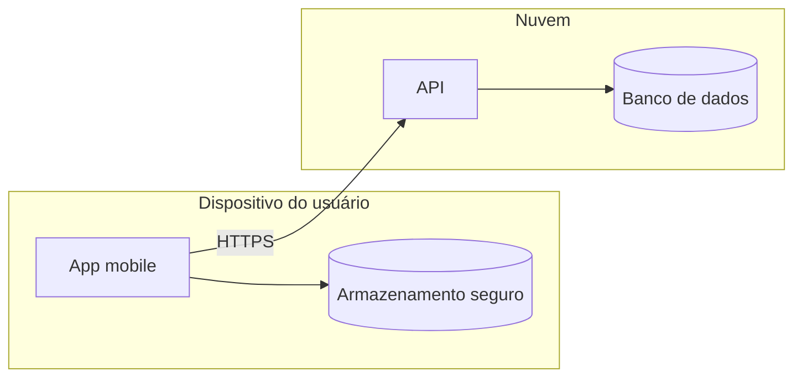

# Modelo de Ameaças

<!--
Modelo. Copie para docs/architecture/modelo-de-ameacas.md.
Baseado em:
- Shostack's Four Question Framework, adotado pelo Threat Modeling Manifesto e pelo OWASP:
  o que estamos construindo, o que pode dar errado, o que vamos fazer a respeito e se fizemos um bom trabalho.
- STRIDE (Microsoft), para encontrar ameaças de forma sistemática.
- OWASP API Security Top 10 e OWASP MASVS, como listas de verificação complementares.

Refaça a análise quando a arquitetura mudar: uma integração ou um fluxo de dados novo pode invalidar a anterior.
-->

- Versão: 0.1
- Data: AAAA-MM-DD

## 1. O que estamos construindo?

### Escopo desta análise

<!-- O sistema todo ou uma parte (ex.: autenticação). -->

### Fluxo de dados e fronteiras de confiança

<!-- Cada subgraph é uma fronteira de confiança: a passagem de dados de uma para outra é onde as ameaças costumam aparecer. -->

### Ativos a proteger

| Ativo | Por que é sensível |
| --- | --- |
| Dados financeiros (contas, transações) | <!-- motivo --> |
| Credenciais e tokens de acesso | <!-- motivo --> |
| <!-- outro ativo --> | <!-- motivo --> |

## 2. O que pode dar errado? (STRIDE)

| ID | Categoria STRIDE | Propriedade violada | Elemento afetado | Ameaça |
| --- | --- | --- | --- | --- |
| AM-01 | Falsificação de identidade (*Spoofing*) | Autenticidade | <!-- elemento --> | <!-- ex.: alguém usa um token roubado para acessar a conta de outro usuário --> |
| AM-02 | Adulteração (*Tampering*) | Integridade | <!-- elemento --> | <!-- ameaça --> |
| AM-03 | Repúdio (*Repudiation*) | Não repúdio | <!-- elemento --> | <!-- ameaça --> |
| AM-04 | Divulgação de informação (*Information disclosure*) | Confidencialidade | <!-- elemento --> | <!-- ameaça --> |
| AM-05 | Negação de serviço (*Denial of service*) | Disponibilidade | <!-- elemento --> | <!-- ameaça --> |
| AM-06 | Elevação de privilégio (*Elevation of privilege*) | Autorização | <!-- elemento --> | <!-- ex.: um usuário lê transações de outro trocando o ID na URL --> |

## 3. O que vamos fazer a respeito?

| Ameaça | Risco | Resposta | Mitigação | Rastreamento |
| --- | --- | --- | --- | --- |
| AM-01 | <!-- alto, médio ou baixo --> | <!-- mitigar, aceitar, transferir ou eliminar --> | <!-- o que será feito --> | <!-- US-NNN, RNF-NN ou issue --> |

## 4. Fizemos um bom trabalho?

- [ ] Toda ameaça da seção 2 tem uma resposta na seção 3
- [ ] Toda mitigação virou história, requisito não funcional, teste ou issue
- [ ] Os itens do OWASP API Security Top 10 foram conferidos para a API
- [ ] Os controles do OWASP MASVS foram conferidos para o app
- [ ] Data da próxima revisão definida: <!-- AAAA-MM-DD ou "quando houver mudança de arquitetura" -->

## Histórico de versões

| Data | Versão | Descrição |
| --- | --- | --- |
| AAAA-MM-DD | 0.1 | Criação do documento |
